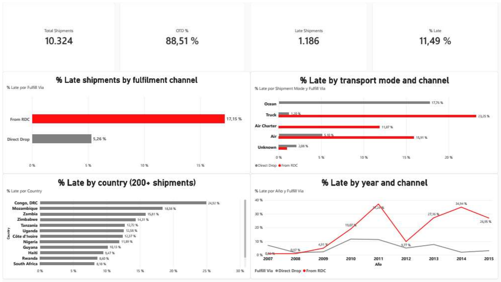

# USAID delivery performance analysis: Excel + Power Query + SQL + Power BI

Ten years of real health-commodity shipments (mostly HIV medicines and test kits, plus some for malaria) sent by the USAID Supply Chain Management System to 43 countries. The question is simple: **how often do shipments arrive late, and why?**

The same analysis is done in **Excel**, **SQL** and **Power BI**, and all three give identical numbers.



## The answer in five lines

1. **11.49 % of shipments arrived late** (1,186 of 10,324). On-time delivery is 88.51 %.
2. **Shipments sent through a regional distribution centre (RDC) are late 3x more often** than shipments sent directly from the vendor: 17.15 % vs 5.26 %. RDC shipments are 78 % of all late shipments (927 of 1,186).
3. **It is not the transport mode.** Within the same mode the gap remains: by truck, 23.25 % (RDC) vs 1.20 % (direct); by air, 15.91 % vs 5.10 %.
4. **The worst countries are RDC-heavy.** In Congo DRC, RDC shipments are late 38 % of the time, direct ones 1.7 %. Nigeria is the exception: there, direct shipments are the late ones (21 % vs 9 %).
5. **The RDC problem started around 2010.** RDC late share was about 1 % in 2007–2008, rose to 37 % in 2011, and stayed between 27 % and 35 % from 2013 to 2015. Direct shipments stayed between 2 % and 12 %.

**Recommendation:** investigate what changed in the RDC process around 2010 (volumes, warehouse capacity, lead-time planning, how the scheduled date is set), starting with Congo DRC, Mozambique and Zambia.

## Data

| File | What it is |
|---|---|
| `data/raw/Raw_Data.csv` | Original export, 10,324 rows × 35 columns, unchanged |
| `data/shipments_clean.csv` | Cleaned subset used by the SQL scripts (id, country, channel, mode, two dates) |

Source: USAID Supply Chain Management System (SCMS) delivery history, a public dataset published by USAID on data.gov.

### Data problems found in the raw export

| Problem | Example | What I did |
|---|---|---|
| Broken text encoding | `Côte d'Ivoire`, a BOM glued to the first header (`ID`) | Replaced with `Côte d'Ivoire`, renamed the header to `ID` |
| Shipment mode missing | `N/A` in 360 rows | Replaced with `Unknown`, kept the rows |
| Freight cost mixes numbers and text | `Freight Included in Commodity Cost`, `Invoiced Separately`, `See ASN-93 (ID#:1281)` | New column `Freight status` explains the text; `Freight USD` keeps only real numbers (6,198 rows) |
| Weight has the same problem | `Weight Captured Separately`, `See DN-304 (ID#:10589)` | Same split: `Weight status` + `Weight kg` |
| Dates and decimals in English format | `2-Jun-06`, `127360.8` | Typed with the English (United States) locale. With a Spanish locale the dot is read as a thousands separator and `0.97` becomes `97` |
| Missing order dates | `Date Not Captured` in 328 rows of *PO Sent to Vendor Date* | Left as is: this column is not used in the analysis |
| Technical columns | `Load_Date`, `Source_System` | Removed |

No rows were deleted: all 10,324 shipments are in every result.

## Process

1. **Clean** in Power Query (`power-query/raw_data_cleaning.pq`): the problems above, plus two new columns:
   - `Days late` = delivered date − scheduled date
   - `Delivery status` = `Late` if `Days late` > 0, otherwise `On time`
2. **Analyse** in Excel with pivot tables (`excel/USAID_Delivery_Analysis.xlsx`): late share by channel × mode and by country × channel.
3. **Check** in SQL (`sql/`): the same five questions, written from scratch, to confirm the numbers.
4. **Report** in Power BI (`powerbi/USAID_Delivery_Dashboard.pbix`): four KPI cards and four charts. Red is always RDC, the channel with the problem; everything else is grey.

### DAX measures

```DAX
Total Shipments = COUNTROWS(Raw_Data1)
Late Shipments  = CALCULATE(COUNTROWS(Raw_Data1), Raw_Data1[Delivery status] = "Late")
% Late          = DIVIDE([Late Shipments], [Total Shipments])
OTD %           = 1 - [% Late]
```

`DIVIDE` instead of `/` so that an empty filter returns blank instead of an error.

### SQL

```sql
SELECT fulfill_via,
       COUNT(*) AS shipments,
       ROUND(100.0 * SUM(CASE WHEN delivered_date > scheduled_date THEN 1 ELSE 0 END) / COUNT(*), 2) AS pct_late
FROM shipments
GROUP BY fulfill_via
ORDER BY pct_late DESC;
```

| Script | What it does |
|---|---|
| `sql/01_create_table.sql` | Creates the table, loads the CSV, checks row count and missing dates |
| `sql/02_analysis.sql` | The five questions (overall, channel, mode × channel, countries with `HAVING COUNT(*) >= 200`, year × channel) |
| `sql/03_analysis_with_cte.sql` | Defines the late flag once in a `WITH` block and compares channels inside the worst countries |

Written for PostgreSQL and tested on PostgreSQL 16.

## Things to keep in mind

- **This is OTD, not OTIF.** The dataset has no delivered quantity, so it says whether a shipment arrived on time, not whether it arrived complete.
- **Small samples are excluded from the country ranking.** Only countries with at least 200 shipments are ranked. Burundi has the highest late share (39 %), but on only 98 shipments; it is worth watching, not ranking.
- **`Unknown` mode looks suspiciously good** (1.1 % late). Shipments with missing data may also have less reliable dates.
- **Late shipments are late by about the same amount in both channels** (median 12 days for RDC, 13 for direct). RDC is late *more often*, not *by more*.
- **Ocean is almost only direct** (366 direct shipments vs 5 RDC), so it cannot be used to compare channels.

## Tools

Excel · Power Query (M) · pivot tables · PostgreSQL · Power BI (DAX)

## Author

**Nordin Khloufi** · [LinkedIn](https://www.linkedin.com/in/nordin-khloufi-data) · [GitHub](https://github.com/nordin94)
